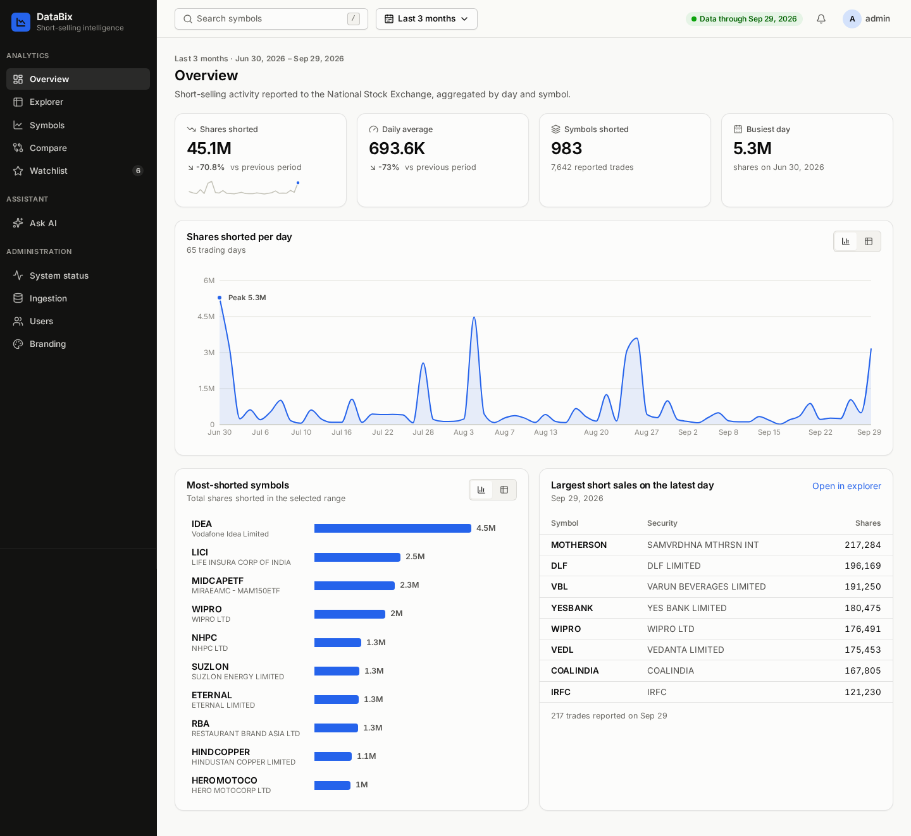
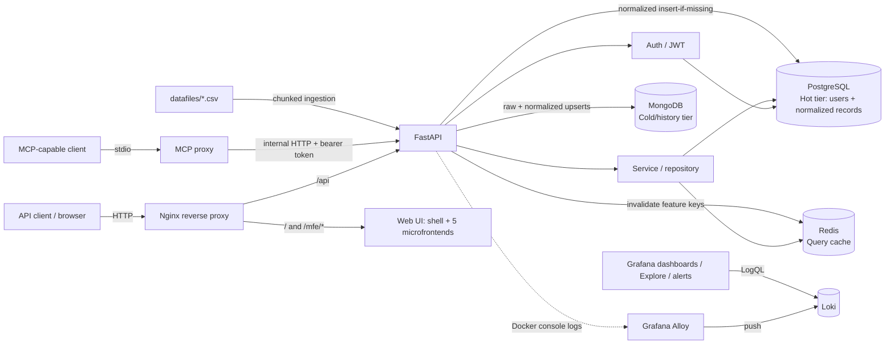
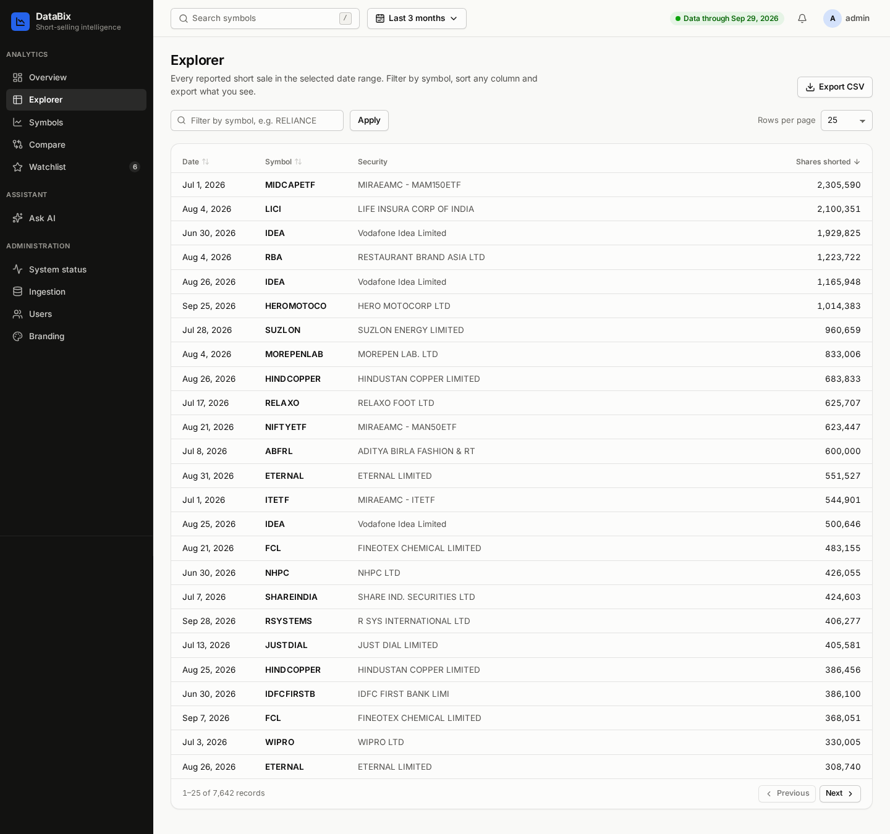
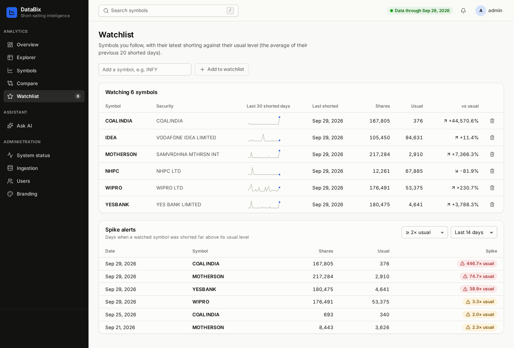
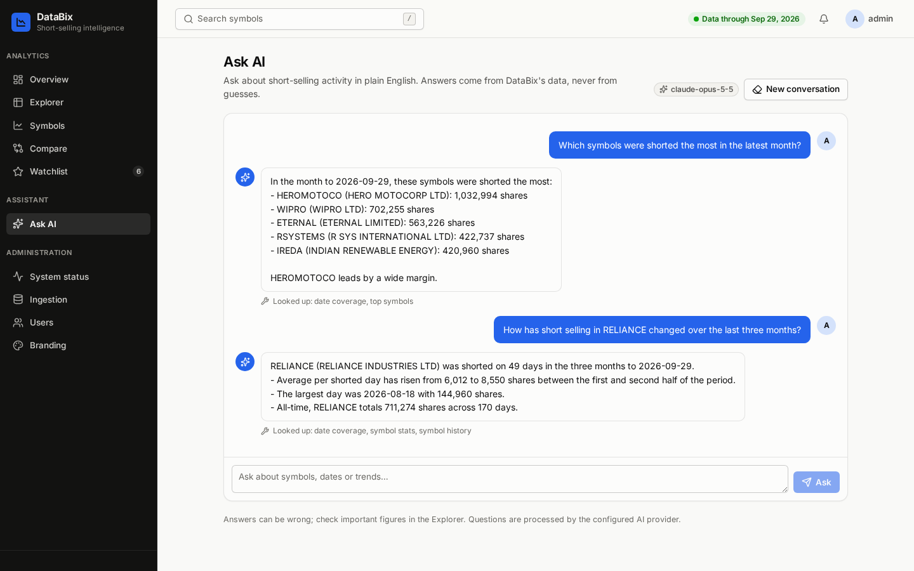
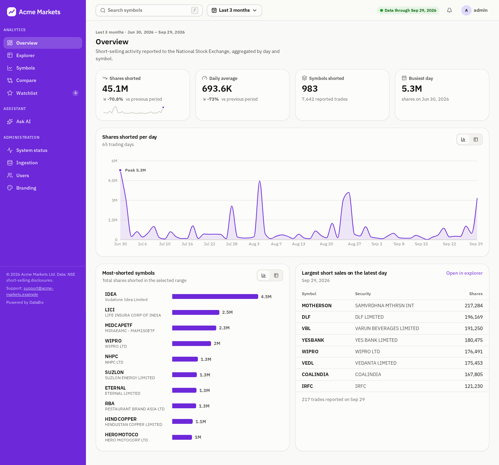

# DataBix Open

# Project summary - DataBix-open
- DataBix-open is a containerized FastAPI microservice for authenticated short-selling data ingestion and retrieval.
- It stores normalized, query-ready records in PostgreSQL (hot tier) and source history in MongoDB (cold tier).
- Chunked CSV ingestion is idempotent; Redis caches filtered API queries and is invalidated after new data is written.
- A React web UI built as microfrontends (a shell plus five independently deployable remotes) covers analytics, a watchlist with spike alerts, an AI assistant, and an admin console with white-label branding.
- Docker Compose orchestrates the API, web UI, databases, cache, Nginx, Grafana, Loki, and Grafana Alloy.
- GitHub Actions runs tests and Compose health checks, then publishes multi-architecture application images to GHCR.

DataBix-open is a blueprint for a small data service with clear API, ingestion, persistence, authentication, caching, telemetry and observability layers, and a microfrontend web UI.



## Contents

- [Features](#features)
- [Architecture](#architecture)
- [Web UI](#web-ui)
- [Data flow and storage](#data-flow-and-storage)
- [API](#api)
- [Run locally with Docker Compose](#run-locally-with-docker-compose)
- [Configuration and security](#configuration-and-security)
- [Tests and CI/CD](#tests-and-cicd)
- [Deployment notes](#deployment-notes)
- [Documentation](#documentation)

## Features

- FastAPI REST API with OAuth2 password login, bcrypt password hashing, JWT bearer authentication, and an administrator role for ingestion.
- PostgreSQL as the hot relational store for users and normalized short-selling records.
- MongoDB as the cold/history store for raw source rows and their normalized projection.
- Chunked CSV ingestion with content hashing, deterministic source-row identity, and repeat-load deduplication.
- Redis cache for filtered and paginated short-selling responses, with cache invalidation after new records are written.
- Analytics API: coverage, range summary, daily totals, top symbols, symbol search/stats/series, sortable lists, CSV export.
- Microfrontend web UI ([frontend/README.md](frontend/README.md)): overview, explorer, symbols, comparison, watchlist and alerts, Ask AI, and admin (status, ingestion, users, branding).
- White-label branding per deployment or from the admin console ([branding/README.md](branding/README.md)).
- Optional AI assistant: Claude with read-only tools over the same data (`ASSISTANT_ENABLED`).
- MCP stdio tools that proxy the authenticated API (records, summary, daily totals, top symbols, symbol search and stats) rather than bypassing application logic.
- Docker Compose stack with Nginx, Grafana, Loki, and Alloy log collection.
- GitHub Actions tests, Compose validation/health check, and GHCR image publishing.

## Architecture



The CSV folder is mounted into the backend container read-only. Alloy discovers containers labeled for log collection; the backend currently has that label. Grafana queries Loki; Alloy is the collector and Loki is the log store.

## Web UI

The web UI lives in [`frontend/`](frontend/README.md): a React shell plus five Module Federation remotes (overview, explorer, symbols, assistant, admin). Each one is built into its own static nginx container and served through the edge proxy on the same origin as the API.

| | |
| --- | --- |
|  |  |
|  |  |

See the [frontend README](frontend/README.md) for the architecture, the shell–remote contract, development workflow, and the full screenshot gallery.

## Data flow and storage

### Hot and cold tiers

- **PostgreSQL (hot tier):** stores users and normalized records in `short_selling_master` for indexed, filtered API queries. The generated record ID is the primary key. Date/symbol pairs are indexed but are intentionally not unique.
- **MongoDB (cold/history tier):** stores raw CSV values and normalized row data in `short_selling_history`. A deterministic document ID incorporates source identity and row number.
- **Redis (cache tier):** stores serialized API pages keyed by all query filters and pagination values. Entries expire after 300 seconds. Redis failures on reads/writes fall back to PostgreSQL; new PostgreSQL inserts invalidate the short-selling cache namespace.

### CSV ingestion

The CSV schema is `Date`, `Symbol`, `Security Name`, and `Quantity`. The parser reads in chunks, validates columns, parses `DD-MMM-YYYY` dates, normalizes symbols to uppercase, handles comma-formatted integer quantities, and skips `-` quantity sentinels while reporting the skipped count.

Ingestion performs two database passes:

1. Upsert raw rows and normalized projections into MongoDB.
2. Insert normalized rows into PostgreSQL, skipping rows already imported from the same source content and row number.
3. Invalidate relevant Redis cache entries after new PostgreSQL rows are written.

Deduplication is per source file (content hash + row number), not per trade. Two files whose date ranges overlap, such as the bundled 12-month and 6-month extracts, therefore count the overlapping trades twice. Ingest only one of them.

MongoDB and PostgreSQL do not share a transaction. If the PostgreSQL pass fails after MongoDB completes, retrying is safe: MongoDB upserts are repeatable and PostgreSQL deduplicates source rows. The HTTP ingestion route is synchronous; clients should wait for its response before starting another load.

## API

Base path: `/api/v1`. Interactive OpenAPI documentation is available at `/docs` when `API_DOCS_ENABLED=true` (off by default).

| Method | Endpoint | Authentication | Purpose |
| --- | --- | --- | --- |
| `GET` | `/health` | Public | Liveness response |
| `POST` | `/api/v1/auth/signup` | Public, disabled by default | Create a user account (only when `AUTH_SIGNUP_ENABLED=true`) |
| `POST` | `/api/v1/auth/token` | Public | Obtain a JWT using OAuth2 form fields `username` and `password` |
| `GET` | `/api/v1/users/me` | Bearer token | Return the current active user |
| `POST` | `/api/v1/short-selling/ingest` | Bearer token, administrator | Ingest the bundled CSV or a named CSV in `datafiles/` |
| `GET` | `/api/v1/short-selling` | Bearer token | Return filtered, sorted (`sort`), paginated records |
| `POST` | `/api/v1/auth/refresh` | Refresh cookie + `X-Requested-With: databix` | Rotate the web session cookie and issue a new access token |
| `POST` | `/api/v1/auth/logout` | Refresh cookie + `X-Requested-With: databix` | End the web session |
| `GET` | `/api/v1/short-selling/coverage` | Bearer token | Earliest/latest date, record and symbol counts |
| `GET` | `/api/v1/short-selling/summary` | Bearer token | Totals, peak day and top symbol for a date range |
| `GET` | `/api/v1/short-selling/daily-totals` | Bearer token | Quantity, records and symbols per trading day |
| `GET` | `/api/v1/short-selling/top-symbols` | Bearer token | Symbols ranked by quantity in a date range |
| `GET` | `/api/v1/short-selling/symbols` | Bearer token | Symbol search (`q`) with all-time totals |
| `GET` | `/api/v1/short-selling/symbols/{symbol}` | Bearer token | All-time statistics for one symbol |
| `GET` | `/api/v1/short-selling/symbols/{symbol}/series` | Bearer token | Daily quantity for one symbol |
| `GET` | `/api/v1/short-selling/export` | Bearer token | Streamed CSV of the filtered records (max 100,000 rows; formula cells neutralised) |
| `GET`, `POST`, `DELETE` | `/api/v1/me/watchlist[/{symbol}]` | Bearer token | The signed-in user's watchlist |
| `GET` | `/api/v1/me/alerts` | Bearer token | Spikes on watched symbols (`days`, `threshold`) |
| `GET`, `POST` | `/api/v1/assistant/status`, `/api/v1/assistant/ask` | Bearer token | AI assistant (when enabled) |
| `GET` | `/api/v1/branding` | Public | White-label branding for the UI |
| `GET` | `/api/v1/admin/status`, `/sources`, `/ingestions` | Administrator | Health, source files, ingestion history |
| `GET`, `POST`, `PATCH` | `/api/v1/admin/users[/{id}]`, `/users/{id}/password` | Administrator | Manage accounts and roles |
| `PUT`, `DELETE` | `/api/v1/admin/branding` | Administrator | Save or reset branding |

Short-selling query parameters:

- `date_from`, `date_to`: ISO dates (`YYYY-MM-DD`), inclusive.
- `symbol`: exact ticker filter; normalized to uppercase.
- `limit`: page size, default `100`, maximum `1000`.
- `offset`: zero-based offset, default `0`, maximum `1000000`.

The ingestion route accepts an optional `filename` query parameter. It must be a CSV basename directly inside `datafiles/`; arbitrary directory paths are rejected. If omitted, the bundled default CSV is used. Example:

```text
POST /api/v1/short-selling/ingest?filename=example-short-selling.csv
```

A bearer token is required for both short-selling routes; ingestion additionally requires an administrator account. Only one ingestion runs at a time; a concurrent request receives `409`. The API currently implements ingestion and read/query operations; it does not expose per-record create/update/delete CRUD endpoints.

## Run locally with Docker Compose

Prerequisites: Docker Engine with Docker Compose v2. Run these commands from the directory containing `docker-compose.yml`:

```bash
cp .env.example .env
```

Edit `.env`: fill in every empty value with unique local values. Compose refuses to start while `JWT_SECRET_KEY`, `POSTGRES_PASSWORD`, `POSTGRES_APP_PASSWORD`, `MONGO_ROOT_PASSWORD`, `MONGO_APP_PASSWORD`, `REDIS_PASSWORD`, or `GRAFANA_ADMIN_PASSWORD` is empty, and the API refuses a `JWT_SECRET_KEY` shorter than 32 bytes. Generate secrets with `python -c "import secrets; print(secrets.token_urlsafe(48))"`. Do not commit `.env` or share actual secrets. Start and inspect the stack:

```bash
docker compose config --quiet
docker compose up --build -d
docker compose ps
```

Check backend health:

```bash
curl --fail http://127.0.0.1:8000/health
```

Open the web UI at `http://localhost`. FastAPI is also available directly at `http://127.0.0.1:8000`. With `API_DOCS_ENABLED=true`, OpenAPI docs are at `http://localhost/docs`.

For a demo with sample accounts, data, watchlists and ingestion history (never in production):

```bash
docker compose exec -e DEMO_PASSWORD='choose-a-password' backend \
  python -m scripts.seed_demo --files Short-Selling-01-10-2025-to-01-10-2026.csv
# add --brand branding/examples/acme.json to try white-labelling
```

This creates `admin` (administrator) and `analyst` with that password.

### Create accounts

Self-service signup is disabled by default. Create an administrator (who can trigger ingestion) and any other accounts from inside the backend container; the password is prompted for, or read from stdin when piped:

```bash
docker compose exec backend python -m auth.manage create-user admin --admin
docker compose exec backend python -m auth.manage create-user mcp-service
```

`python -m auth.manage` also supports `list-users`, `set-password`, `grant-admin`, `revoke-admin`, `deactivate`, and `activate`.

### HTTPS

The default stack binds plain-HTTP Nginx to `127.0.0.1:80` only. For a network-facing deployment, put the certificate chain and key at `certs/fullchain.pem` and `certs/privkey.pem` and start with the TLS override, which serves HTTPS on 443 (Mozilla "intermediate" TLS settings, HSTS), redirects port 80, and stops publishing the API's loopback port so every request passes through Nginx:

```bash
docker compose -f docker-compose.yml -f docker-compose.tls.yml up -d
```

### Host access

| Service | Local address | Notes |
| --- | --- | --- |
| Web UI and API (Nginx) | `http://localhost:80` | Loopback-only by default (`NGINX_HTTP_BINDING`). Use `docker-compose.tls.yml` for HTTPS on public interfaces. Login is rate limited to 10 requests/minute per client IP; the assistant to 6/minute. |
| FastAPI | `http://127.0.0.1:8000` | Loopback host binding. |
| PostgreSQL | `localhost:<configured-host-port>` | Host port is configured by `POSTGRES_PORT_BINDING`; service-to-service port is `5432`. |
| MongoDB | `localhost:27017` | Host-published for local administration; credentials from `.env`. |
| Redis | `localhost:6379` | Redis protocol, password from `REDIS_PASSWORD`; memory capped by `REDIS_MAXMEMORY`. |
| Grafana | `http://localhost:3000` | Admin password from `.env`. |
| Loki | Not published | Unauthenticated, so only reachable inside Compose; Grafana uses `http://loki:3100`. |
| Alloy | `http://localhost:12345` | Local collector UI; reads container logs through a read-only Docker API proxy instead of the raw socket. |
| MCP | No host HTTP port | MCP uses stdio; connect through an MCP-capable client. |

All published ports are loopback-bound by default. Host port values can be changed through Compose variables. From containers, use Compose service names (`postgres_db`, `mongodb`, `redis_cache`, `loki`, `fastapi_backend`) rather than `localhost`.

### Put CSV files in the ingestion directory

The Compose service mounts the host `datafiles/` folder to `/app/datafiles` in the backend as read-only. To add a source file on a server, copy it into the project’s `datafiles/` folder; the running container sees it without rebuilding the image. Then call the authenticated ingestion route with its basename. The API cannot write or replace files through this mount.

A mounted folder is suited to controlled server-side batch ingestion and large files. Multipart HTTP upload is not implemented. If external clients need uploads, add explicit request/file size limits, content validation, safe storage names, and temporary-file handling.

### Trigger ingestion

Using an administrator account (see [Create accounts](#create-accounts)), request a bearer token from the token route using form-encoded credentials, and call ingestion with `Authorization: Bearer <token>`. Example with curl (replace placeholders):

```bash
curl -X POST \
  'http://localhost/api/v1/short-selling/ingest?filename=example-short-selling.csv' \
  -H 'Authorization: Bearer <JWT_TOKEN>'
```

The response reports `source_file`, `mongo_rows`, `postgres_rows`, and `skipped_rows`. The bundled file can be selected by omitting `filename`. The CLI is also available inside the backend container:

```bash
docker compose exec backend python -m ingestion
```

See [CSV ingestion docs](docs/ingestion.md) for format, idempotency, and failure behavior.

## Configuration and security

Copy `.env.example` to `.env` and provide deployment-specific values. Variables include:

- `JWT_SECRET_KEY`: random signing key of at least 32 bytes; required by Compose and enforced by the API.
- `POSTGRES_USER`, `POSTGRES_PASSWORD`, `POSTGRES_DB`, `POSTGRES_PORT_BINDING`: PostgreSQL superuser (container initialization only), database, and host binding.
- `POSTGRES_APP_USER`, `POSTGRES_APP_PASSWORD`: least-privilege role the API connects as (created by `db/postgres/10-app-role.sh`).
- `MONGO_ROOT_USERNAME`, `MONGO_ROOT_PASSWORD`, `MONGODB_DATABASE`: MongoDB root account (container initialization only) and application database.
- `MONGO_APP_USER`, `MONGO_APP_PASSWORD`: `readWrite` user on the application database that the API connects as (created by `db/mongo/10-app-user.js`).
- `REDIS_URL`, `REDIS_PASSWORD`, `REDIS_MAXMEMORY`: Redis connection, password (required), and cache memory cap.
- `MCP_BACKEND_USERNAME`, `MCP_BACKEND_PASSWORD`: service-account credentials for the MCP proxy; create the account with `python -m auth.manage create-user` first.
- `AUTH_SIGNUP_ENABLED`: allow public `POST /api/v1/auth/signup` (default `false`). Signup never creates administrators.
- `API_DOCS_ENABLED`: serve `/docs`, `/redoc`, and `/openapi.json` (default `false`).
- `NGINX_HTTP_BINDING`: host address for plain-HTTP Nginx (default `127.0.0.1:80`).
- `AUTH_COOKIE_SECURE`, `REFRESH_TOKEN_DAYS`: web-session refresh cookie (Secure by default; 7-day sessions).
- `BRANDING_FILE`: JSON file with the deployment's default branding (e.g. `/app/branding/default.json`).
- `ASSISTANT_ENABLED`, `ASSISTANT_MODEL`, `ANTHROPIC_API_KEY`: optional AI assistant (default model `claude-opus-5-5`).
- `APP_VERSION`: shown on the admin status page.
- `WEB_IMAGE_PREFIX`, `WEB_IMAGE_TAG`: names of the six web UI images.
- `GRAFANA_ADMIN_PASSWORD`: Grafana admin password.
- `BACKEND_IMAGE`: optional image name override.
- `CORS_ORIGINS`: comma-separated browser origins; empty (the Compose default) allows none. Credentialed CORS is disabled because auth uses bearer headers.
- `FORWARDED_ALLOW_IPS`: proxies whose `X-Forwarded-For`/`-Proto` headers uvicorn trusts (default: Docker private ranges, where Nginx runs).
- `DATABASE_URL`: optional SQLAlchemy URL override; when set, it takes precedence over the separate PostgreSQL settings.

Security notes:

- `.env` contains secrets and must remain untracked. Use unique secrets in each environment and a secret manager in deployment.
- Signup is disabled by default and can never create administrators; only administrators can trigger ingestion. Accounts are managed with `python -m auth.manage`.
- Nginx rate-limits login/signup per client IP, caps request bodies, and hides its version. If another load balancer sits in front, configure Nginx's real-IP module so limits apply per end client.
- Use `docker-compose.tls.yml` (or TLS at a trusted load balancer) for any network-facing deployment; plain HTTP is loopback-only by default.
- The API connects to PostgreSQL and MongoDB with least-privilege accounts, not the superuser/root accounts, so a compromised API cannot run server-side programs or administer the databases.
- Keep PostgreSQL, MongoDB, Redis, Loki, and Alloy private. Alloy reaches Docker through `wollomatic/socket-proxy`, which accepts only Alloy and only the read-only endpoints it needs (ping, version, container and network listing, events, inspect, logs). Container inspection still returns environment variables, so the proxy runs on an internal-only network.
- Nginx overwrites `X-Forwarded-For` with the connecting address and the API logs that client IP with each request and ingestion.
- The runtime image runs as an unprivileged user and installs only hash-pinned runtime dependencies from `requirements.lock`.
- Startup uses SQLAlchemy `create_all` for missing tables, not schema migrations. Add a migration strategy before production schema evolution.

## Tests and CI/CD

Run tests from the project directory:

```bash
python -m pip install --require-hashes -r requirements.lock
python -m pip install --require-hashes -r requirements-dev.lock
python -m pytest -q
docker compose config --quiet
```

`requirements.txt` and `requirements-dev.txt` hold the version ranges; `requirements.lock` and `requirements-dev.lock` are the hash-pinned sets generated from them with `uv pip compile` (the exact commands are at the top of each lock file).

The tests cover authentication, route behavior, filtering/pagination, cache behavior, ingestion order/deduplication, and invalidation using an in-memory SQLite database or test doubles. The production Compose runtime uses PostgreSQL.

GitHub Actions in `.github/workflows/ci-cd.yml` runs tests, audits locked dependencies with `pip-audit`, validates Compose (including the TLS override), starts the Compose stack, checks backend health directly and through Nginx, and confirms backend logs reach Loki through the socket proxy. It also runs weekly so new vulnerabilities in locked dependencies are flagged without a push. Actions and images are pinned to digests, and Dependabot keeps them current. On pushes to `main` and version tags (`v*`), the publish job builds and pushes a multi-architecture application image to GHCR. Pull requests to `main` run CI but do not publish. The workflow does **not** automatically deploy to a server; deployment infrastructure and credentials must be configured separately.

## Deployment notes

For a first deployment, use a Linux host with Docker Engine and Compose v2, clone the project, create a private server-side `.env`, configure persistent storage and backups, then start the stack with Compose. If using the GHCR image, set `BACKEND_IMAGE` to the published image/tag and pull it before starting. Keep private image access tokens out of source control.

Before public production use, enable TLS (`docker-compose.tls.yml`), firewall rules, secret management, durable database and Loki/Grafana storage, backups, monitoring/alert destinations, and a migration plan. 

### Upgrading an existing deployment

1. Add the new variables to `.env`: `POSTGRES_APP_PASSWORD`, `MONGO_APP_PASSWORD`, `REDIS_PASSWORD`, and a `JWT_SECRET_KEY` of at least 32 bytes.
2. Create the least-privilege database accounts (both scripts are idempotent; on new data directories they run automatically):

   ```bash
   docker compose up -d postgres_db mongodb
   docker compose exec postgres_db sh /docker-entrypoint-initdb.d/10-app-role.sh
   docker compose exec mongodb sh -c 'mongosh --quiet -u "$MONGO_INITDB_ROOT_USERNAME" -p "$MONGO_INITDB_ROOT_PASSWORD" --authenticationDatabase admin /docker-entrypoint-initdb.d/10-app-user.js'
   ```

3. Start the stack. Startup adds the `users.is_admin` column to existing databases.
4. Review accounts created while signup was public, and promote an operator:

   ```bash
   docker compose exec backend python -m auth.manage list-users
   docker compose exec backend python -m auth.manage deactivate <username>
   docker compose exec backend python -m auth.manage grant-admin <username>
   ``` Current CI publishes images but does not perform server deployment.

## Documentation

- [Architecture and configuration](docs/architecture.md)
- [Short-selling flow and schema](docs/short-selling-flow.md)
- [CSV ingestion](docs/ingestion.md)
- [Authentication](docs/authentication.md)
- [Database and cache](docs/database.md)
- [Telemetry, Grafana, Loki, and Alloy](docs/telemetry.md)
- [End-to-end testing and deployment runbook](docs/end-to-end-testing.md)
- [Endpoint tests](docs/tests.md)
- [Data models](docs/models.md)
- [Docker troubleshooting notes](docs/docker.md)
- [Application routes](docs/main.md)
