# DataBix web UI: a microfrontend blueprint

A React UI split into a **shell** and five **remotes** (microfrontends) that are
built, versioned and deployed independently, composed at runtime with
[Module Federation](https://module-federation.io/) on Vite.


## Architecture

```mermaid
flowchart LR
	Browser --> Edge[Edge nginx: TLS, rate limits, CSP]
	Edge -->|/| Shell[web_shell]
	Edge -->|/mfe/overview/| Overview[web_overview]
	Edge -->|/mfe/explorer/| Explorer[web_explorer]
	Edge -->|/mfe/symbols/| Symbols[web_symbols]
	Edge -->|/mfe/assistant/| Assistant[web_assistant]
	Edge -->|/mfe/admin/| Admin[web_admin]
	Edge -->|/api/| API[FastAPI]
	Shell -. fetches /remotes.json, loads remoteEntry.js .-> Overview & Explorer & Symbols & Assistant & Admin
```

| Piece | Path | Owns |
| --- | --- | --- |
| `apps/shell` | `/` | Layout, sign-in, navigation, global date range, symbol search (`/` or Ctrl+K), alerts bell, theme, branding |
| `apps/overview` | `/overview` | KPIs, daily trend, most-shorted symbols, latest day |
| `apps/explorer` | `/explorer` | Filterable, sortable, paginated records; CSV export |
| `apps/symbols` | `/symbols`, `/symbols/:symbol`, `/compare`, `/watchlist` | Directory, symbol detail, 3-way comparison, watchlist and spike alerts |
| `apps/assistant` | `/assistant` | Ask-AI chat over the data (Claude with read-only tools) |
| `apps/admin` | `/admin/*` (admins only) | System status, ingestion, users, white-label branding |
| `packages/sdk` | shared singleton | Typed API client (generated from OpenAPI), session, branding/theme, date range, data hooks |
| `packages/ui` | shared singleton | Design system: tokens, components, charts |
| `packages/devhost` | dev only | Runs one remote on its own with the shell's providers |

**The contract between shell and remotes**:
- Each remote exposes `./App`, a component that renders its own `<Routes>`.
- The shell reads [`public/remotes.json`](apps/shell/public/remotes.json) at runtime. Each remote entry gives `entry`, the `routes` it owns, `rangeScoped` routes where the date filter shows, and `adminOnly`. The navigation lives in the same file.
- Adding a section means deploying a container and adding it to `remotes.json`; the shell is not rebuilt.

**Shared state**: React, React Router, TanStack Query, Recharts, `@databix/sdk` and `@databix/ui` are Module Federation singletons ([`mf.shared.mjs`](mf.shared.mjs)), so every remote sees the same router, query cache, session, theme and date range. Remotes talk through the URL (filters live in query strings) and the shared SDK, never through each other.

**Resilience**: each remote renders inside an error boundary. A remote that fails to load shows a retry card while the rest of the app keeps working.

## Security model

- **Same origin.** Everything is served from one origin via nginx, so CORS stays off. The CSP is strict: `script-src 'self'`, no third-party fonts or analytics. Fonts are self-hosted.
- **Tokens.**
  - The access token lives only in memory.
  - The session survives reloads through an HttpOnly, `SameSite=Strict` refresh cookie scoped to `/api/v1/auth`. It rotates on every use, and reuse of an old token is detected.
  - Refreshes are serialised across tabs with the Web Locks API.
  - The cookie endpoints require an `X-Requested-With` header, which blocks CSRF.
- **Untrusted text is never HTML.** React escapes security names, assistant answers and branding text, and there is no `dangerouslySetInnerHTML`. Post-login redirects accept only same-origin paths.
- **Authorization is enforced by the API.** The shell hides admin navigation and refuses to load the admin remote for non-admins, but every admin action is authorised server-side regardless.

## Development

```bash
cd frontend
corepack enable              # pnpm is pinned (with hash) in package.json
pnpm install
pnpm typecheck && pnpm test && pnpm build
```

Run the API locally on port 8000, then use one of these:

```bash
# Everything with hot reload: the shell on :5173 loads each remote's dev
# server (ports 5174-5178, listed in apps/shell/public/remotes.dev.json)
pnpm dev                                   # then open http://localhost:5173

# One remote on its own, with sign-in, for the team that owns it
pnpm --filter @databix/symbols dev         # http://localhost:5176/mfe/symbols/
```

After changing backend models, regenerate the typed client (CI fails if it is stale):

```bash
python -m scripts.export_openapi frontend/packages/sdk/openapi.json   # from the repo root
pnpm generate:api                                                      # from frontend/
```

## White-labelling

Product name, logo, favicon, colours, sidebar style, font, corner radius, default theme, footer and support email:
- set per deployment with `BRANDING_FILE`, or
- by administrators in **Administration → Branding**, with a live preview.

No rebuild is needed. See [`../branding/README.md`](../branding/README.md), including how brand colours are kept accessible automatically.

| Default | White-labelled (`branding/examples/acme.json`) |
| --- | --- |
|  |  |

## Charts

Charts follow a documented data-visualisation method:
- Thin marks, a hairline grid, a value-first tooltip, and a direct label on the peak.
- A table view behind every chart, so no value depends on hover or colour.
- One axis per chart.
- Comparison colours from a palette validated for colour-vision deficiency, stable per symbol.

Brand colours are only used for chart marks when they pass the palette's lightness, chroma and contrast checks in that mode (see `packages/sdk/src/branding/color.ts`).

## Testing and screenshots

```bash
python -m scripts.seed_demo --files Short-Selling-01-10-2025-to-01-10-2026.csv   # demo users, data, watchlists
E2E_BASE_URL=http://localhost E2E_PASSWORD=... pnpm e2e                           # smoke tests
E2E_BASE_URL=http://localhost E2E_PASSWORD=... SCREENSHOT_DIR=../screenshots pnpm screenshots
```

CI runs the smoke and screenshot suites against the full Docker Compose stack and uploads the screenshots as a build artifact.

### Gallery

| | |
| --- | --- |
| 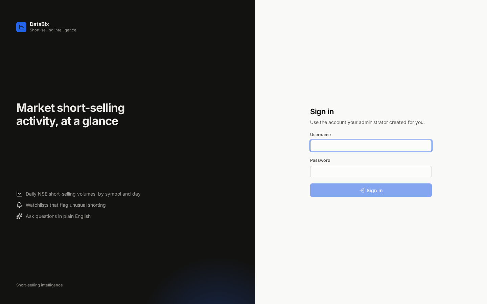 Sign in | 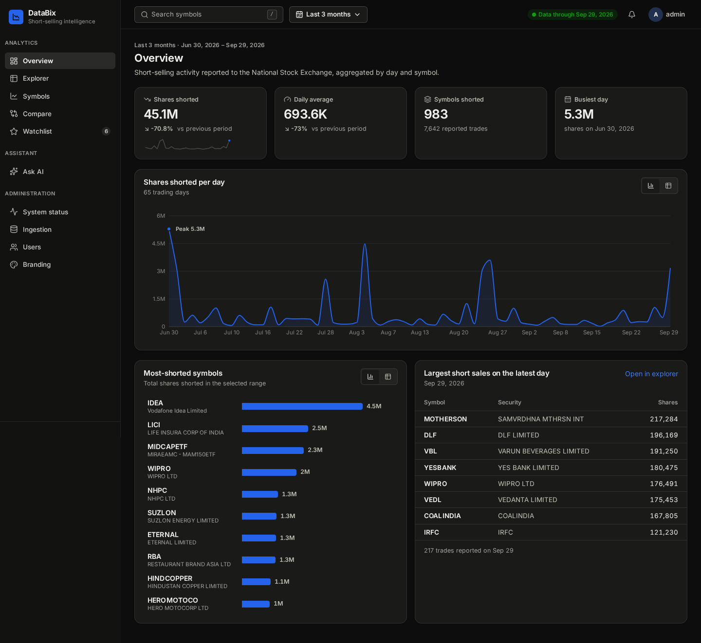 Overview, dark mode |
|  Explorer | 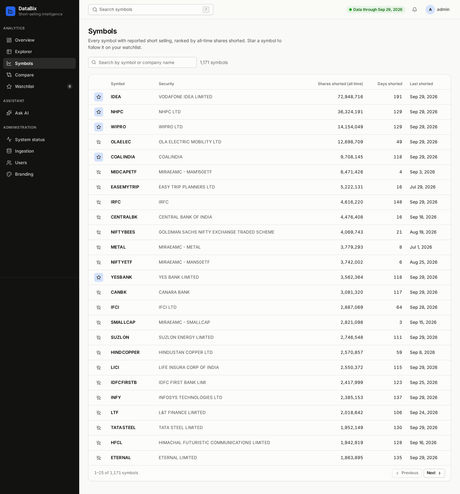 Symbols |
| 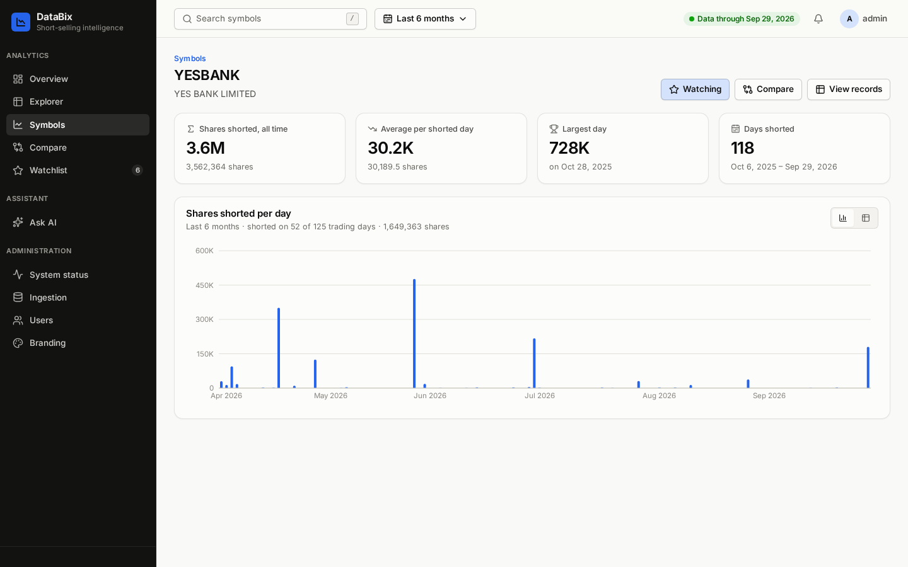 Symbol detail | 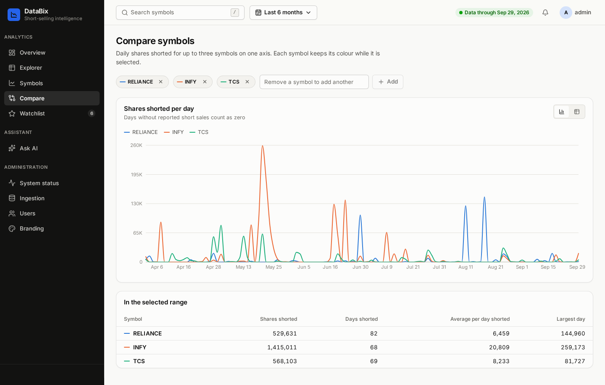 Compare |
|  Watchlist and spike alerts | 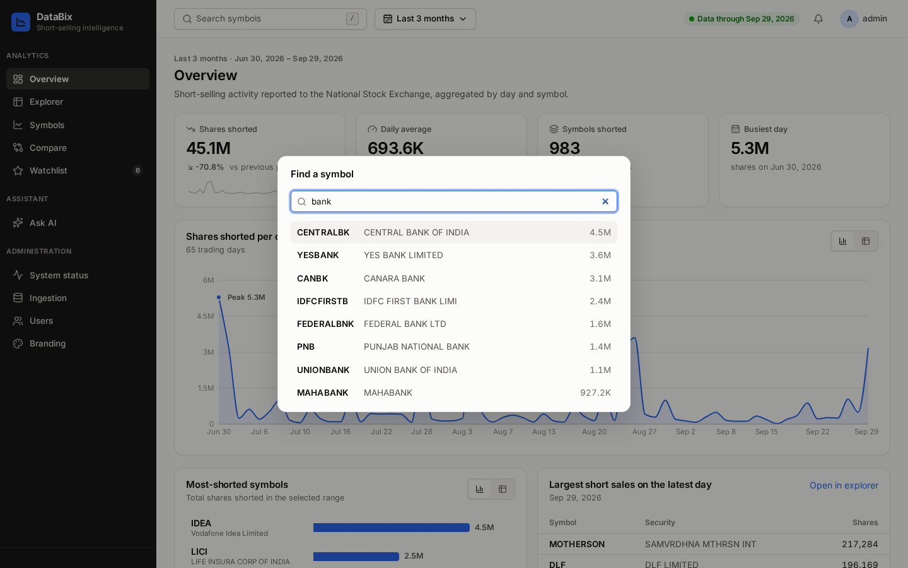 Symbol search |
|  Ask AI | 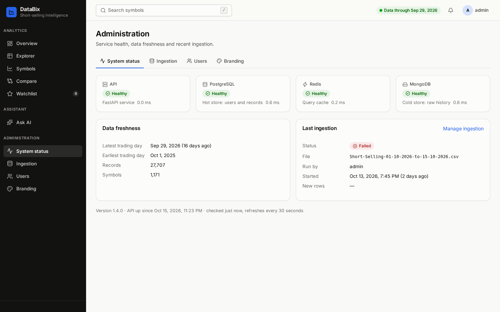 System status |
| 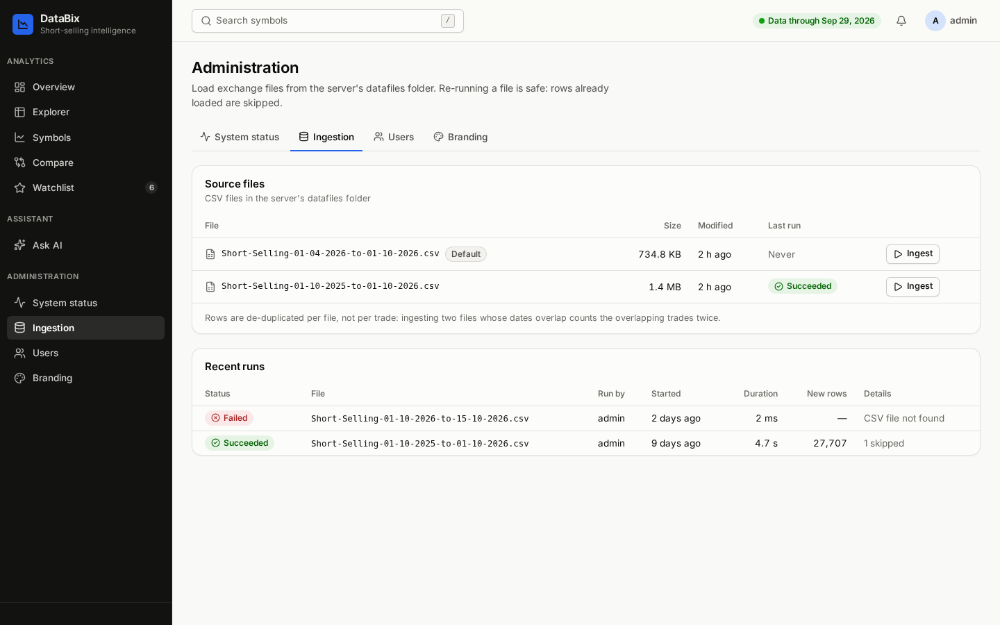 Ingestion | 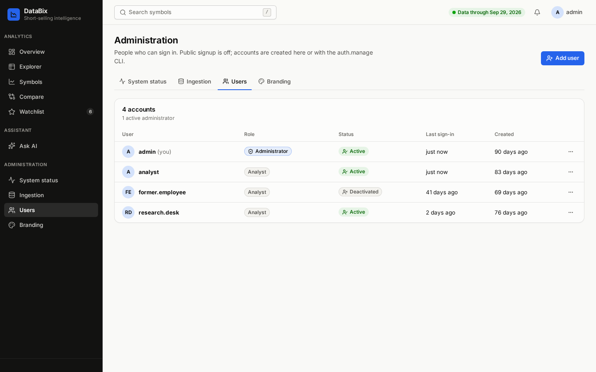 Users |
| 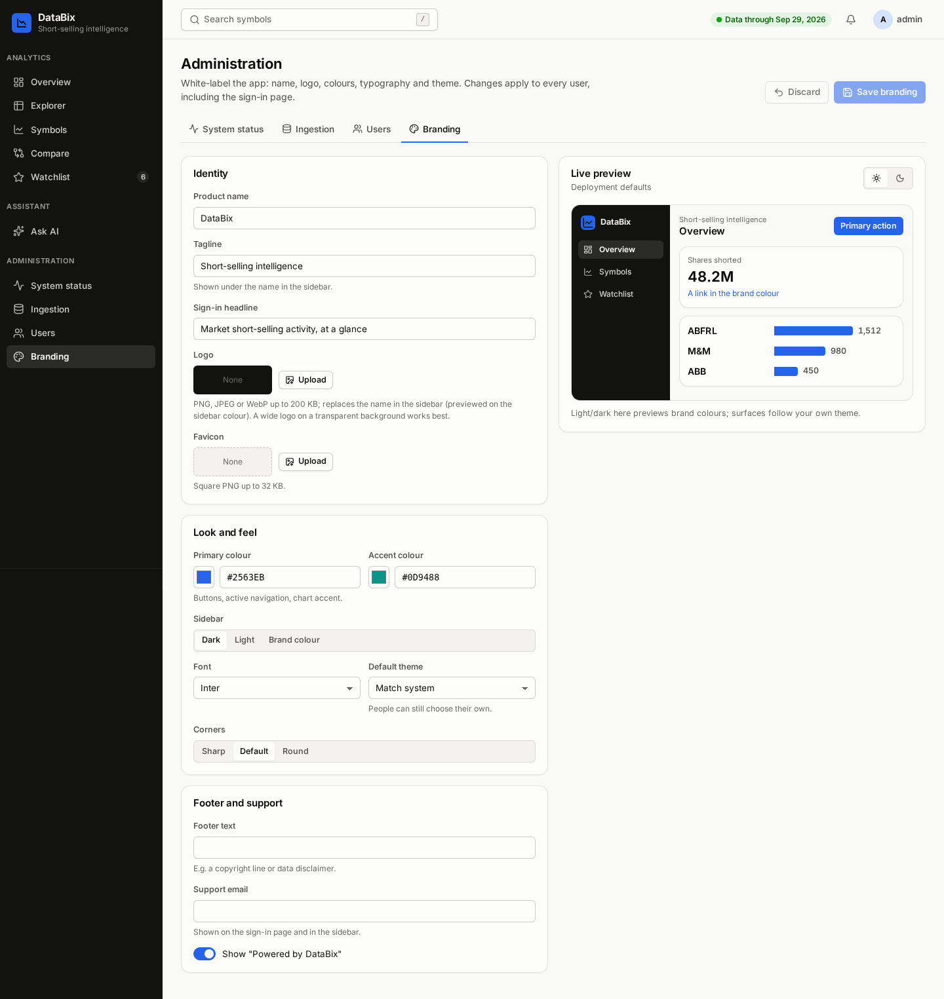 Branding editor | 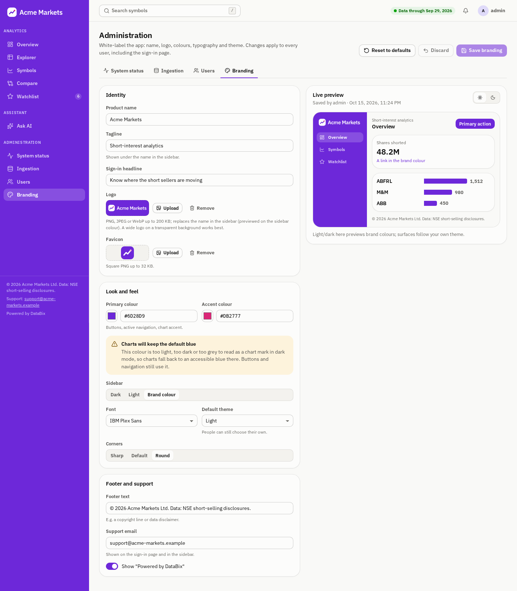 Branding editor, Acme |
| 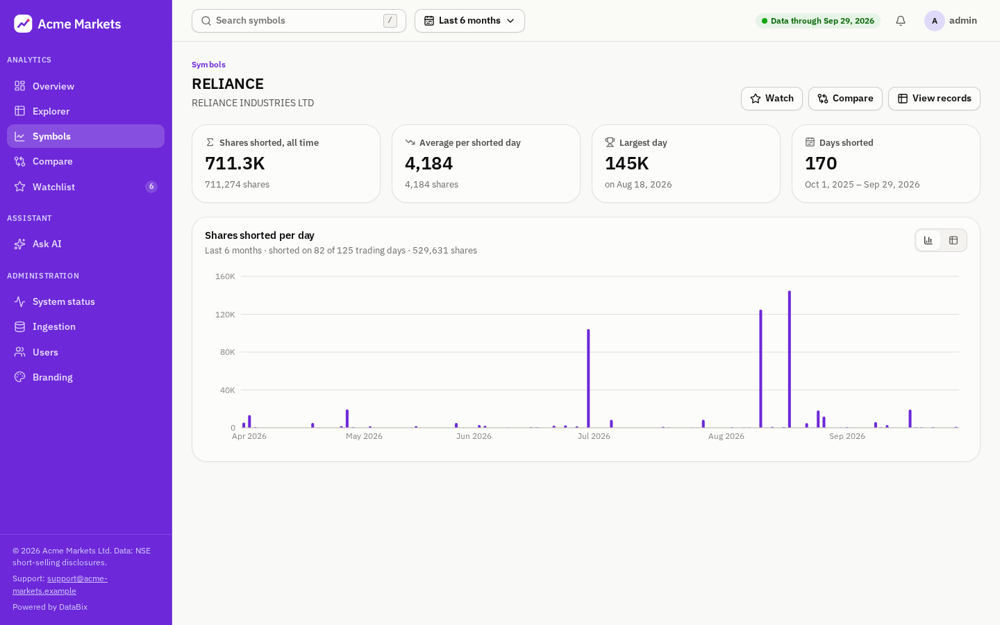 Symbol page, Acme | 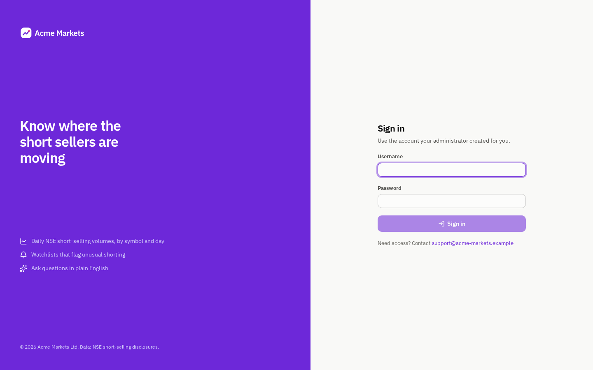 Sign in, Acme |
| 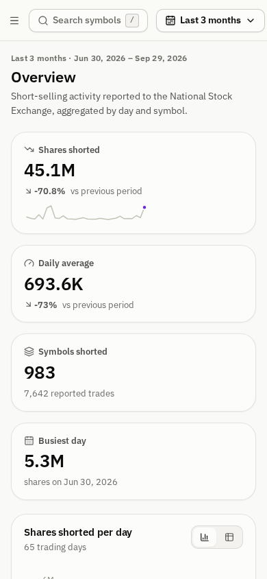 Mobile | 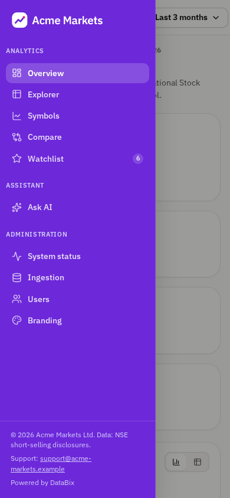 Mobile navigation |

The Ask-AI screenshot was captured against `scripts/fake_claude_api.py`, a local stand-in for the Claude API. Its tool calls ran against the real demo database. With `ASSISTANT_ENABLED=true` and an Anthropic API key, the assistant uses `claude-opus-5-5`.
